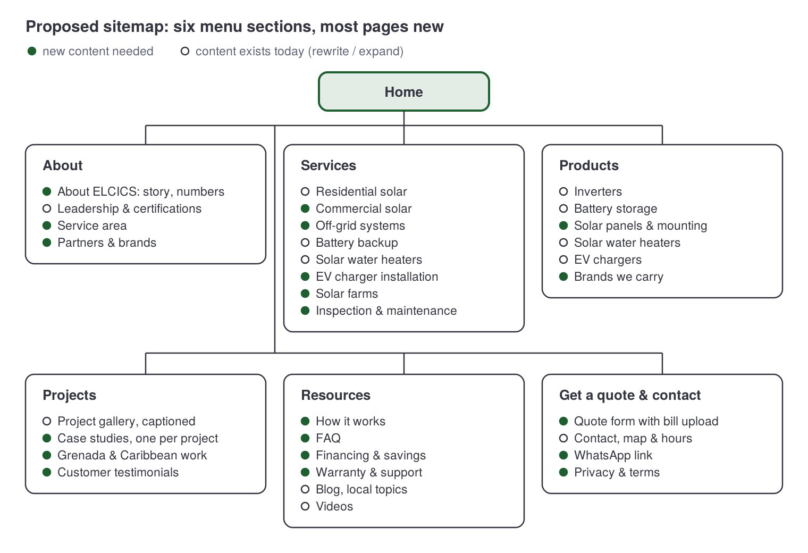

# ELCICS Ltd. Website – Content Audit & Redesign Plan

Oct 17, 2026 · Von

## Summary

The current site at [elcicsltdtt.com](https://www.elcicsltdtt.com/) is a 7-page Wix site that has strong raw material (real project photos, NABCEP credentials, 9 years of history, Grenada work) but presents it thinly: no prices or process, no project case studies, no FAQ, no testimonials, and a quote path that relies on email links.

- **Pages audited:** Home, Products, Services, Contact, Certifications, Videos, Blog (1 post). Confirmed against the site's sitemap.xml, so nothing is hidden.
- **Images saved:** 89 original-resolution files in `images/` (and Google Drive), sorted into 8 page folders.
- **Where each image is used:** `docs/image-inventory.csv` — page, section, current alt text, notes, original URL.
- **Biggest content gaps:** no project case studies (52 gallery photos with zero captions), no customer proof, no "how it works" or pricing guidance, no FAQ, thin About and Contact pages, and a generic blog post that is not about ELCICS or Trinidad.

## Current sitemap

The site has 6 menu pages plus 1 blog post; three of them sit under a "More" menu, and "About" just links back to the homepage.

| Menu label | URL | Page title (SEO) | Meta description | Images |
| --- | --- | --- | --- | --- |
| About (= Home) | [/](https://www.elcicsltdtt.com/) | Renewable Energy Solutions \| Elcics Ltd. – Trinidad and Tobago | Elcics Ltd. delivers premium renewable energy solutions in Trinidad and Tobago. Reduce costs and embrace sustainable power today! | 10 |
| Products | [/product](https://www.elcicsltdtt.com/product) | Solar Power Products & Expert Installation \| Elcics Ltd. | Explore Elcics Ltd.'s premium solar energy products and services… certified maintenance… | 11 |
| Services | [/service](https://www.elcicsltdtt.com/service) | Certified Solar Panel Installation for Homes & Businesses \| Elcics Ltd. | …certified solar technicians… Get a free consultation today! | 5 + 52 gallery |
| Contact | [/contact](https://www.elcicsltdtt.com/contact) | Get in Touch \| Elcics Ltd. – Solar Solutions & Support | …Contact us today for a free consultation! | 0 |
| More › Certifications | [/cv](https://www.elcicsltdtt.com/cv) | Certifications & Credentials \| Elcics Ltd. – Trusted Solar Experts | …our NABCEP Board Certified PV System Inspector… | 3 |
| More › Videos | [/blank-page](https://www.elcicsltdtt.com/blank-page) | Learn About Solar Power \| Educational Videos by Elcics Ltd. | Explore Elcics Ltd.'s educational videos on solar energy… | 4 thumbnails |
| More › Blog | [/blog](https://www.elcicsltdtt.com/blog) | Blog \| ELCICS Ltd. | Explore expert insights… EV charging… real-world project updates | 1 |
| (blog post) | [/post/transforming-the-future-with-renewable-energy](https://www.elcicsltdtt.com/post/transforming-the-future-with-renewable-energy) | Discover the Power of Renewable Energy | Discover the benefits and advancements of renewable energy… | 3 |

**Site-wide header:** logo, tagline "We Make It Happen with Solar Power", Trinidad (868) 682-1490, Mobile 1(868) 620-2188, info@elcicsltdtt.com, Facebook, Instagram, links to Green Solutions SKN and Studer Innotec (unlabelled icons), "Request a Quote" (opens an email). **Footer:** Riverview Park, Longdenville, Chaguanas, Trinidad, W.I.; phone, mobile, email, same social and partner links. A Wix chat widget appears on every page.

## Content inventory by category

Every piece of text on the site, regrouped by topic so it can be reused in the redesign. Wording is kept as it appears (typos flagged in the next section). Image IDs match the image inventory.

### 1. Brand & positioning

- **Name:** ELCICS Ltd. (also written Elcics Ltd.)
- **Tagline (header):** We Make It Happen with Solar Power
- **Home headline:** Premium Solar & Battery Solutions for Homes and Businesses
- **Home sub-headline:** ELCICS Ltd. delivers professionally designed solar systems, battery backup solutions, and clean installations built for reliability, performance, and long-term value.
- **Mission:** To deliver clean, reliable, and professionally engineered energy solutions that enpower homes and businesses with greater energy independence, long-term value, and environmental resonsibility.
- **Logo:** SITE-01 (only a ~5 KB file exists on the site; recreated vector in `brand/logo/`)

### 2. About the company

- **Who we are:** Renewable energy company established in 2017, specialising in the design, installation and servicing of solar power systems for residential and commercial applications.
- **How we work:** High-quality solar and energy solutions using trusted equipment, professional workmanship, and sound engineering practices; systems built for reliability, resilience, and long-term value.
- **Industry development:** ELCICS Ltd. & Studer Innotec solar inverter product technical training, Kapok Hotel, 2018 (HOME-02).
- **Partners linked in header/footer:** Green Solutions International (greensolutionsskn.com), Studer Innotec (studer-innotec.com).

### 3. Leadership & credentials (Certifications page)

- **Junior Goodluck, Co-Founder** — Licensed Electrician, NABCEP Board Certified PV System Inspector, Certified PV Installation Professional; experience across Trinidad and Tobago and the wider Caribbean; leadership in PV quality assurance, compliance, installation standards, inspection and electrical workmanship.
  - NABCEP Board Certified PV System Inspector — Certification No. PVSI-021023-013628 (CERT-01)
  - NABCEP Associate – Photovoltaic — Credential ID PVA-121820-035281 (CERT-02)
  - City & Guilds Assured Solar PV Certification — Credential ID 211219/A00W-01/822048/EHF4732/M/25/04/735502677205/40
- **Everton Connor, Co-Founder** — Electrical Engineer, in renewable energy since 1990 (30+ years); work and consulting on solar power plant projects across the Caribbean; renewable energy design, implementation and project leadership.
- **Photo:** technician at Wigton Wind Farm (CERT-03). No headshots.

### 4. Products (distributor/supplier)

Intro: Authorized distributor and supplier of selected solar energy products and solutions for residential and commercial applications in Trinidad and Tobago. Brands named: Studer, Huawei, GoodWe, SMA, Deye, Enphase, Schneider, Growatt, SOL-ARK, Relion, Pytes, TESVOLT Powerwall, Iron Ridge, Chiko.

| Category | Product | Description on site | Image |
| --- | --- | --- | --- |
| Inverters | Studer XTM | Reliable inverter solutions for advanced off-grid and backup systems. | PROD-02 |
| Inverters | Huawei | Smart inverter technology for modern residential and commercial systems. | PROD-03 |
| Inverters | GoodWe | Efficient inverter solutions for residential and commercial solar applications. | PROD-04 |
| Inverters | Deye | Hybrid inverter solutions for solar, backup, and energy management. | PROD-05 |
| Battery storage (BESS) | Huawei | Smart battery storage solutions for modern hybrid energy systems. | PROD-06 |
| Battery storage (BESS) | GoodWe | Efficient battery storage systems for residential and commercial applications. | PROD-07 |
| Battery storage (BESS) | Deye | Scalable battery storage for backup power and energy management. | PROD-08 |
| Battery storage (BESS) | Pytes | Reliable lithium battery storage for solar backup and energy resilience. | PROD-09 |
| Solar water heater | ELCICS Solar Water Heater | Efficient solar AC/DC water heating for residential applications. | PROD-10 |
| EV charger | GoodWe EV Charger | Smart EV charging solutions for residential and commercial use. | PROD-11 |

### 5. Services

- **Intro:** Solar, battery backup, and energy solutions for homes, businesses, and commercial properties. We design, supply, and install reliable systems tailored to your needs.
- **Residential Solar Systems** — Reliable solar and backup power solutions for homes. (SERV-02)
- **Solar Water Heaters** — Efficient solar water heating solutions for residential use. (SERV-03)
- **Battery Backup Systems** — Reliable backup power solutions for homes and businesses. (HOME-08)
- **Also mentioned elsewhere:** servicing/maintenance (About, SEO text), EV charging and "related electrical solutions" (Contact), commercial work (Home).

### 6. Projects & portfolio

| Project | Location | Description on site | Image |
| --- | --- | --- | --- |
| 8kW off-grid solar PV system | Matura, Trinidad | Reliable off-grid solar solution supplied and installed by ELCICS Ltd. | HOME-04 |
| 8kW solar inverter & 20kWh lithium system | Matura, Trinidad | Designed for dependable backup and energy storage. | HOME-05 |
| 12kW whole home backup system | Valencia, Trinidad | Supports critical household loads and improves resilience. | HOME-06 |
| 25kW solar array | Cumuto, Trinidad | Installed for reliable solar generation. | HOME-07 |
| 25kW residential off-grid system | Cumuto, Trinidad | Powers the entire home with off-grid energy. | HOME-08 |
| 3kW townhouse backup systems | Innocent Manor, Chaguanas | Backup power for essential household loads. | HOME-09 |
| 75 kW solar farm | St. George's, Grenada | (no description) | HOME-10 |
| Solar farm installation | not stated | Utility-scale solar project. | SERV-04 |
| Rooftop solar installation | not stated | PV installation in progress. | SERV-05 |
| Project gallery | not stated | 52 uncaptioned photos | GAL-01 to GAL-52 |

### 7. Media (Videos page)

- **ELCICS-hosted:** TECU Eco Mobility & Energy Expo · Kobani Kawana Off-grid Cottage · ELCICS Agri Expo video · ELCICS TikTok (VID-01 to VID-04)
- **YouTube embeds from other channels:** Building a solar workforce for the future · Register now for NABCEP solar certification, Dec 16–20, 2019 in Jamaica · About Green Solutions International · Online NABCEP Solar Certification with GSI

### 8. Blog

- **One post:** "Transforming the Future with Renewable Energy" by elcicsltdtt2017, Jul 27, 2025, 4 min read. Generic overview: global clean energy, 7 types of renewable energy, benefits, challenges, action steps. Cites IRENA 2018 jobs data. Nothing about Trinidad, ELCICS projects or products. Images BLOG-01 to BLOG-03 (generic).

### 9. Contact & conversion

- **Phones:** (868) 682-1490 (Trinidad) · (868) 620-2188 (mobile)
- **Email:** info@elcicsltdtt.com
- **Address:** Riverview Park, Longdenville, Chaguanas, Trinidad, W.I. (footer only)
- **Social:** [Facebook](https://www.facebook.com/Elcicstt2017/) · [Instagram](https://www.instagram.com/elcicsltd.tt/)
- **Contact page text:** ELCICS Ltd. is here to help with solar energy, battery backup, solar water heating, EV charging, and related electrical solutions. Send us your inquiry and our team will respond as soon as possible. Form fields: Name, Email, Phone, Subject, Message.
- **Services page quote form:** First Name, Last Name, Email, Phone/WhatsApp, Comments.
- **Calls to action:** Request a Quote (email link), Get in Touch, GET A QUOTE, View Full Gallery.

## Content weak points

The biggest problem is that the site says *what* ELCICS does in one-line claims but never proves it with detail, numbers, outcomes or customer voices. Design is out of scope here; these are information gaps only.

### Site-wide

| Issue | Where | Why it matters |
| --- | --- | --- |
| No customer testimonials, reviews or client names anywhere | All pages | Solar is a large purchase; buyers look for proof from people like them. |
| No numbers on track record (systems installed, total kW, years, islands served) | Home, About | "Established 2017" is the only hard fact; 2017 to 2026 is 9 years, never stated. |
| No "how it works" process (site visit → design → quote → install → handover → support) | All | Buyers don't know what happens after they enquire. |
| No pricing guidance, financing, payback or savings information | All | The #1 question for solar buyers is cost and return; nothing answers it. |
| No warranty, maintenance or after-sales information | All | "Servicing" is claimed in About and SEO text but never described. |
| No service area statement | All | Trinidad, Tobago and Grenada appear, but where ELCICS will travel is never said. |
| No business hours, no WhatsApp link (though the quote form asks for WhatsApp) | Header, Contact | Basic contact information missing. |
| Two phone formats: (868) 682-1490 vs "Mobile: 1(868) 620-2188" | Header vs footer | Inconsistent; one should be clearly labelled as WhatsApp if it is. |
| Partner links are unlabelled icons (Green Solutions SKN, Studer) | Header, footer | Visitors can't tell what they are or why ELCICS is linked to them. |
| Brand written three ways: ELCICS Ltd., Elcics Ltd., "ECICS Ltd." (typo) | Home, SEO titles | Inconsistent name weakens trust and search. |
| Alt text is mostly camera filenames or missing (e.g. "20170709_161808.jpg", "IMG-0109.JPG") | Most images | Lost search and accessibility value; see the image inventory. |
| Stock/generic images used where real ones exist (HOME-03, SERV-01, BLOG-01–03) | Home, Services, Blog | Stock technicians on the Services hero undercut the "real installer" message. |

### Home

- Typos in the mission statement: "enpower" → empower, "resonsibility" → responsibility; "ECICS Ltd." in the 25kW Cumuto caption.
- Size mismatches between captions and image alt text: 25kW caption vs "24 KWP" and "SOL ARK 24KW" alt text — confirm the real figures.
- Featured projects give size + town only: no customer type, problem solved, equipment used, outcome (bill savings, hours of backup) or date.
- The Grenada 75 kW solar farm — the largest project on the site — has no description at all.
- The training section shows one 2018 event; nothing newer suggests the company is current.
- "About" in the menu just points to the homepage; there is no real About page.

### Products

- 14 brands are named but only 4 brands across 10 products are shown; SMA, Enphase, Schneider, Growatt, SOL-ARK, Relion, TESVOLT, Iron Ridge and Chiko have no product information.
- No solar panels (modules), mounting/racking or monitoring are listed, though they are core to every install.
- Product blurbs are generic one-liners with no model numbers, capacities (kW/kWh), warranties, datasheets or "best for" guidance.
- "Authorized distributor" is claimed without saying for which brands, or offering proof.
- "TESVOLT Powerwall" mixes two different brands (TESVOLT; Powerwall is Tesla) — confirm what is meant.
- No way to ask about a specific product, check stock or get a price.

### Services

- Only 3 services described (residential solar, solar water heaters, battery backup), each in one line. Commercial solar, off-grid systems, solar farms, EV charger installation, inspections, maintenance and repairs are done (per other pages) but not described.
- The 52-photo gallery has no captions, locations or project names.
- "Get in Touch" button links to a malformed address (http://elcicsltd.tt2017@gmail.com/), which is broken and exposes a different Gmail address.
- SEO text promises "free consultation" and "certified maintenance" that the page never explains.

### Contact

- No address, map, hours or phone numbers on the page itself (they live only in the footer).
- The form's "Request a Quote" button opens an email draft instead of sending the form, so typed details may be lost.
- No guidance on what to include for a quote (location, monthly electricity bill, roof type, backup needs).

### Certifications

- Strong content, but buried under "More" and titled "Certifications" at /cv.
- Only Junior Goodluck's credentials are listed; Everton Connor's qualifications and the company's own registrations (licensing, T&TEC approvals, insurance) are absent.
- No headshots or team beyond the two co-founders.
- The bio and "years of experience" are not linked to project results.

### Videos

- The page URL is /blank-page.
- 4 of 8 videos belong to Green Solutions International, including a 2019 training registration that has long expired.
- Videos have no descriptions or context.

### Blog

- One post in total, July 2025; generic global content with 2018 statistics; nothing on Trinidad electricity rates, T&TEC, hurricane resilience, or ELCICS projects.
- Ends with "visit this resource" pointing nowhere specific.
- Author shown as a username (elcicsltdtt2017), not a person.

## Missing pages

A solar installer site of this kind usually has 13 pages ELCICS lacks; the first five matter most because they answer the questions buyers ask before they call.

| Priority | Missing page | What it should contain | Source material already available |
| --- | --- | --- | --- |
| High | **About Us** (real page) | Story since 2017, mission, values, team, service area, track-record numbers, partners | Home About text, Certifications page, Studer training |
| High | **Projects / Case studies** (one page per key project) | Client type, location, problem, system size and equipment, outcome, photos, date | 9 captioned projects + 52 gallery photos (need captions) |
| High | **How it works / Our process** | Steps from enquiry to handover and support, typical timeline | None — needs client input |
| High | **Get a Quote** (dedicated form) | Location, monthly bill, roof type, backup needs, upload a bill/photo, WhatsApp | Two existing forms to merge |
| High | **FAQ** | Cost, payback, grid-tie vs off-grid vs hybrid, battery life, hurricanes, T&TEC approval, maintenance, warranties | None — needs client input |
| Medium | **Individual service pages** | Residential solar, commercial solar, off-grid, battery backup, solar water heaters, EV chargers, solar farms, inspections & maintenance | One-line service blurbs |
| Medium | **Testimonials / Reviews** | Customer quotes with name, town, system; Google/Facebook reviews | None — collect from clients |
| Medium | **Warranty, Maintenance & Support** | What's covered, service plans, response times, how to log an issue | None |
| Medium | **Financing & Savings** (or savings calculator) | Payment options, bank/credit union partners, typical payback in T&T | None |
| Low | **Brands / Partners** | Each brand carried, what ELCICS is authorized for, datasheets | Products brand list, partner links |
| Low | **Commercial & Grenada / Caribbean** | Larger-scale and regional work | 75 kW Grenada farm, co-founder Caribbean experience |
| Low | **Privacy Policy & Terms** | Data use for forms and chat | None (legal requirement for forms) |
| Low | **Careers / Training** | Training history, apprenticeships, NABCEP links | 2018 Studer training, Videos page |

## Proposed sitemap

The redesign moves from 6 thin pages to 6 menu sections with about 32 pages; 20 of them need new content from the client.

Where today's content goes:

| Current page / content | Moves to |
| --- | --- |
| Home hero, mission, "Who we are" | Home (hero, short intro) + About ELCICS |
| Home featured projects (7) + Services selected installations (3) | Projects › case studies and gallery |
| Home Studer training (2018) | About › Partners & brands, or a blog post |
| Products page (10 products, 14 brands) | Products, one page per category + Brands we carry |
| Services page (3 services) | Services, one page per service (8) |
| Services project gallery (52 photos) | Projects › gallery, captioned and filtered by type |
| Certifications page (/cv) | About › Leadership & certifications |
| Videos page (/blank-page) | Resources › Videos (ELCICS videos only) |
| Blog (1 post) | Resources › Blog, rewritten around local topics |
| Contact page + Services quote form | Get a quote & contact |

## Brand: logo and colours

The logo is now a vector traced from the site's own artwork, keeping the header logo's 140 × 140 frame and position exactly, so it scales to any size without blurring. Files are in `brand/logo/`.

**How it was made:** traced from the sharper 319 × 212 copy of the logo on the Products page, then aligned over the 140 × 140 header file so every line sits where it does today. Shapes, proportions and the cropped left fingertip match the header logo; the only additions are the faint leaf veins, redrawn as hairlines.

| File | Use |
| --- | --- |
| ELCICS-logo.svg | Master vector, 140 × 140, transparent: use this on the new site |
| ELCICS-logo-white-bg.svg | Same, on white |
| ELCICS-logo.pdf | Vector for print and signage |
| ELCICS-logo-140/1120/2240/4480 px .png | Same framing at 1×, 8×, 16×, 32× (transparent and white) |
| ELCICS-logo-full-artwork.svg / 3190 × 2120 .png | Uncropped version with the full hand, from the Products page artwork |

### Colour palette

The current site has no brand colour in use: everything is Wix theme charcoal and grey, with the logo green appearing only in the logo. The palette below keeps the site's real colours and makes the logo green the primary.

| Role | Name | Hex | Where it comes from | Use |
| --- | --- | --- | --- | --- |
| Primary | ELCICS Green | #1D5F2F | Measured from the logo's solid fill | Headings, buttons, links, icons |
| Primary | Forest Dark | #144221 | Darker shade of the logo green | Hover states, footer |
| Primary | Leaf Mid | #6C9778 | Lighter tint of the logo green | Icons, dividers on dark |
| Primary | Green Mist | #DDE7E0 | Light tint of the logo green | Cards, tags, section backgrounds |
| Primary | Green Tint | #F1F5F3 | Very light tint | Subtle backgrounds |
| Accent | Solar Gold | #F8BD26 | Site theme accent (set but unused today) | Badges, highlights, CTA on dark |
| Accent | Gold Deep | #8B6504 | Site theme | Gold text on white |
| Neutral | Charcoal | #33343F | Site body text and dark sections | Body text, dark sections |
| Neutral | Slate | #5F6176 | Site theme | Secondary text, captions |
| Neutral | Grey 400 | #9293A6 | Site theme | Placeholders, disabled |
| Neutral | Mist Grey | #C8C9D3 | Site theme, Services section | Borders, form outlines |
| Neutral | Off-White | #F7F7F7 | Site section background | Alternate sections |
| Neutral | White | #FFFFFF | Site background | Main background |

**Contrast checks (WCAG):** green on white 7.7:1 and charcoal on white 12.3:1 both pass AAA for text. Solar Gold on white is only 1.7:1, so gold is never used for text on light backgrounds; it works on charcoal (7.2:1) or behind charcoal text. Unstyled links on the current site show in browser-default blue (#0000EE); the redesign should use ELCICS Green.

**Fonts on the current site:** Helvetica (headings) and Avenir Light (body), both Wix theme defaults.

## Projects: 9 case studies + placeholders

The Projects section launches with the 9 systems the site already describes, each as its own case study. The other 47 gallery photos stay on the site as placeholder cards with neutral captions, so they can be upgraded one by one as the client sends details.

### The 9 case studies

Everything below comes from the site's captions, image descriptions (alt text) and photo filenames; nothing is invented. "Photo dated" comes from the camera or WhatsApp filename.

| # | Case study | Location | System (as stated on site) | Extra details found in site files | Photos | Still needed from client |
| --- | --- | --- | --- | --- | --- | --- |
| 1 | Off-grid guest house | Matura, Trinidad | 8kW off-grid solar PV, supplied and installed by ELCICS | Filename "Solar guest house"; also used on Services as "Completed Residential Project" | HOME-04 | Client type, panels, battery, outcome, year |
| 2 | Inverter + lithium storage | Matura, Trinidad | 8kW solar inverter & 20kWh lithium, for backup and storage | Photo dated 30 May 2022 · may be the same site as #1 | HOME-05, GAL-03 | Same site as #1? Inverter and battery brands |
| 3 | Whole-home backup | Valencia, Trinidad | 12kW, supports critical household loads | Alt text: Sol-Ark 12kW · photo dated 30 May 2023 | HOME-06 | Battery size, backup hours, panels |
| 4 | Residential solar array | Cumuto, Trinidad | 25kW solar array | Alt text says 24 kWp · photo dated 14 Nov 2021 | HOME-07, GAL-19 | Confirm 24 or 25 kW; same site as #5? |
| 5 | Whole-home off-grid | Cumuto, Trinidad | 25kW residential off-grid, powers the entire home | Alt text: Sol-Ark, 24kW · filename "Jr solar project 1" · also the Services "Battery Backup" photo | HOME-08, GAL-11 | Confirm size; battery capacity |
| 6 | Townhouse backup | Innocent Manor, Chaguanas | 3kW backup systems (plural) for essential loads | — | HOME-09 | How many townhouses; equipment |
| 7 | Solar farm | St. George's, Grenada | 75 kW solar farm | Photo dated 3 Dec 2021 · low-res WhatsApp image | HOME-10, GAL-08 | Client, ELCICS's role, completion date, hi-res photos |
| 8 | Utility-scale solar farm | Not stated | "Utility-scale solar project" | Filename "ELCICS CU solar presentation" | SERV-04 | Name, location, size |
| 9 | Rooftop installation | Not stated | "PV installation in progress" | — | SERV-05, GAL-02 | Name, location, size |

**Each case study page uses the same template**, so placeholders can fill in later without redesign:

- Title, location, year
- System at a glance: size (kW), type (grid-tie / hybrid / off-grid), battery (kWh), inverter, panels
- The challenge: what the client needed
- What ELCICS did: design, supply, install, commissioning
- The result: backup hours, bill savings, reliability
- Customer quote (optional)
- Photo gallery
- Call to action: "Want a system like this? Get a quote"

Any field without an answer is left off the live page instead of showing "TBC".

### Placeholder cards (kept on the site)

The remaining 47 gallery photos fall into 4 groups. On the live site they appear in the Projects gallery with a neutral caption and no invented details. Once the client identifies a photo, it moves into a new case study (Project 10, 11 and so on).

| Group | Live caption until confirmed | Photos | Count |
| --- | --- | --- | --- |
| Rooftop & ground-mount arrays | Solar PV installation by ELCICS Ltd. | GAL-01, 07, 09, 10, 13, 14, 16, 18, 20, 21, 23, 26, 28, 36 | 14 |
| Inverter & battery installations | Inverter and battery system installed by ELCICS Ltd. | GAL-04, 06, 12, 15, 17, 22, 29, 30, 31, 32, 33, 34, 37, 52 | 14 |
| Solar water heaters | ELCICS solar water heater installation | GAL-05, 27 | 2 |
| Team, training & events | ELCICS team at work / training / expos | GAL-24, 25, 35, 38–51 | 17 |

The last group belongs on About (team) and Resources (training, expos) rather than Projects. GAL-35 shows an ELCICS display at what looks like an agri expo and likely matches the "ELCICS Agri Expo" video. GAL-07 (an array above a bay) and GAL-09 (a large commercial rooftop) look like strong candidates for full case studies, possibly Grenada; ask the client.

GAL-02, 03, 08, 11 and 19 are already in the case studies above. With 9 case studies and 4 placeholder groups, all 52 gallery photos are accounted for.

## Information to request from the client

These answers fill the gaps above; nothing below can be written well without them.

- [ ] Approval of the recreated logo and colour palette (original logo source file, if one exists)
- [ ] Track record: number of systems installed, total kW installed, islands and regions served
- [ ] Correct figures for the Cumuto projects (24 or 25 kW) and the brand list ("TESVOLT Powerwall")
- [ ] Captions for the 52 gallery photos: project, town, system size, year
- [ ] 3–5 projects to turn into case studies, with the outcome (bill before/after, backup hours) and client permission
- [ ] 5–10 customer testimonials with names and towns (or permission to show Google/Facebook reviews)
- [ ] Step-by-step process and typical timeline from enquiry to switch-on
- [ ] Price ranges or "starting from" figures, financing partners, typical payback
- [ ] Warranty terms (equipment and workmanship) and maintenance plans
- [ ] Service area, business hours, WhatsApp number, which phone is primary
- [ ] Everton Connor's qualifications; headshots of both co-founders; any other team members
- [ ] Company registrations, licences, T&TEC approvals, insurance
- [ ] Which brands ELCICS is officially authorized for; datasheets for products to feature
- [ ] Which Gmail address (elcicsltd.tt2017@gmail.com) is still in use, if any
- [ ] Whether to keep the Green Solutions International videos and partner link
- [ ] Topics for 4–6 local blog posts (e.g. T&TEC net-billing, hurricane-ready backup, solar water heater savings)

## Sources

- [ELCICS Ltd. website](https://www.elcicsltdtt.com/) — all 7 pages and the blog post, read 17 Oct 2026; page list confirmed from the site's sitemap.xml
